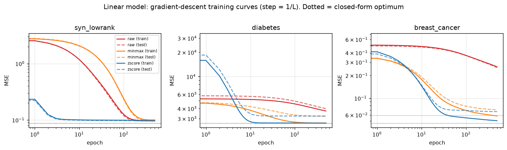
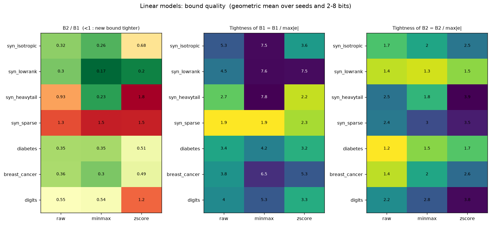
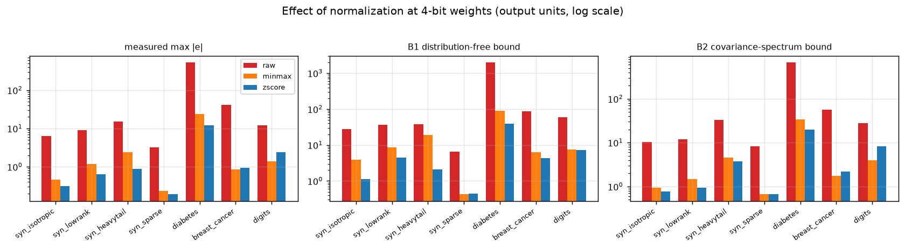

# Quantization Error Bounds

**Input-statistics-dependent worst-case error bounds for uniformly quantized linear models, with feature normalization as an error-reduction mechanism.**

Course project for *Mathematics for AI*, Department of Artificial Intelligence & Data Science, School of Computing, FAST-NUCES.

**Team:** Iman Mughal (26i-7674), Um e Aimen (26i-7670), Zahra Ahmed (26i-7656)

> Status: **initial experiments**. The code, training graphs and first results are complete; the formal normalization theorem and the sparsity refinement are planned for the next stage (see [Limitations and next steps](#limitations-and-next-steps)).

---

## Overview

When a model's weights are stored with only a few bits (uniform quantization), its output changes slightly. For a linear unit with quantized weights `w_q = w + Δw`, the output error is

```
e(x) = Δwᵀx
```

A **bound** is a guarantee `|e(x)| ≤ B`. A bound is **tight** when `B` is close to the largest error that actually occurs; we measure this with the *tightness ratio* `B / max|e|` (1 = perfect, larger = more pessimistic).

The classical bound is distribution-free and ignores the data. This project asks:

- **RQ1.** Do input statistics (mean, covariance spectrum, variance) give a tighter bound for plain uniform quantization?
- **RQ2.** Does feature normalization (min-max, z-score) reduce the error and the bounds, and by how much?
- **RQ3.** How tight are the bounds in practice, across bit-widths (2 to 8) and input regimes?

## Methods

| Bound | Formula | Idea |
|---|---|---|
| **B1** (baseline, Anguita et al. 1999) | `|e| ≤ max‖x‖₁ · ‖Δw‖∞` | Hölder's inequality; valid for any data, but pessimistic |
| **B2** (proposed) | `|e| ≤ |Δwᵀμ| + R · √(Δwᵀ(Σ+εI)Δw)` | Cauchy-Schwarz in the covariance geometry; `R` is the largest Mahalanobis radius of the training data; minimised over a grid of `ε` |

- **Quantizer:** uniform min-max grid with `2^b` levels, round-to-nearest, `|Δw_i| ≤ Δ/2`.
- **Scalings:** `raw`, `minmax`, `zscore`, fitted on the training set only; the model is refitted after each scaling.
- **Models:** closed-form linear regression, and a one-hidden-layer ReLU MLP (NumPy, Adam) with a composed layer-wise bound.
- **Metrics:** measured max and RMS output error, B1, B2, tightness ratios, violation rate, and task performance (MSE or accuracy) before and after quantization.

## Datasets

| Dataset | Type | Features | Purpose |
|---|---|---|---|
| `syn_isotropic` | synthetic | 40 | uncorrelated Gaussian reference |
| `syn_lowrank` | synthetic | 40 | rank-5 covariance plus small noise |
| `syn_heavytail` | synthetic | 40 | Student-t (3 d.o.f.) outliers |
| `syn_sparse` | synthetic | 40 | about 10% non-zeros |
| `diabetes` | real (scikit-learn, unscaled) | 10 | mixed feature scales |
| `breast_cancer` | real (scikit-learn) | 30 | mixed scales, linear probability model |
| `digits` | real (scikit-learn) | 64 | many zero pixels |

The MLP is evaluated on a synthetic nonlinear low-rank task, `diabetes` and `breast_cancer`.

## Repository structure

```
.
├── qbounds.py            # quantizer, scalers, InputStats (B1, B2), linear fit, NumPy MLP
├── run_experiments.py    # runs all experiments, writes results/ and figures/
├── sanity_checks.py      # tests the building blocks and the validity of the bounds
├── requirements.txt
├── results/              # CSV tables (raw runs and summaries)
└── figures/              # training graphs and result plots
```

## Getting started

Requires Python 3.10 or newer.

```bash
# 1. create and activate a virtual environment
python -m venv venv
venv\Scripts\activate          # Windows
# source venv/bin/activate     # macOS / Linux

# 2. install dependencies
pip install -r requirements.txt

# 3. (optional) verify the building blocks
python sanity_checks.py

# 4. run every experiment (a few minutes)
python run_experiments.py
```

Outputs are written to `results/` (CSV tables) and `figures/` (PNG plots). All random seeds are fixed, so runs are reproducible.

## Figures produced

| File | Content |
|---|---|
| `fig1_training_linear.png` | gradient-descent training curves, linear model |
| `fig2_training_mlp.png` | training / validation loss, MLP |
| `fig3_linear_error_vs_bits.png` | measured error vs. B1 and B2 against bit-width |
| `fig4_linear_heatmaps.png` | B2/B1 and tightness ratios per dataset and scaling |
| `fig5_linear_normalization.png` | effect of raw / min-max / z-score at 4 bits |
| `fig6_mlp_error_vs_bits.png`, `fig6b_mlp_heatmaps.png` | MLP error and bound quality |
| `fig7_task_metric_vs_bits.png` | task performance after quantization |





## Initial results

Numbers are geometric means over 10 seeds (linear models) and 5 seeds (MLP); see `results/linear_summary.csv` and `results/mlp_summary.csv` for the full tables.

- **RQ1.** B2 is smaller than B1 in 75% of the 1,470 linear runs. The ratio B2/B1 is 0.17 to 0.30 on low-rank data, 0.26 to 0.68 on isotropic data, and 0.30 to 0.52 on breast_cancer and diabetes. B2 is *looser* than B1 on sparse data (1.3 to 1.55) and on heavy-tailed z-scored data (1.8).
- **RQ2.** Moving from raw to z-score inputs reduces the measured error by about 7x (digits) to 55x (diabetes), with similar reductions in both bounds. Neither min-max nor z-score dominates.
- **RQ3.** The tightness ratio is 1.9 to 7.8 for B1 and 1.2 to 3.9 for B2. For the MLP the composed bounds are looser (B1 13 to 36 times, B2 5 to 18 times the measured error), with no violation in any of the 315 runs.

## Limitations and next steps

1. **Calibration constants.** B1 and B2 use constants (largest `‖x‖₁`, radius `R`) estimated on the training set; a very small fraction of test points exceed them (mean violation rate below 0.06% in every dataset-scaling cell). Planned: per-sample B1 and a calibration set with a safety margin.
2. **Closed form.** The a-priori version of B2 (using only the step Δ) is looser than the a-priori B1; the reported gains refer to the data-dependent B2 computed from the realized rounding errors.
3. **Sparsity.** The Hölder refinement under sparsity is not yet implemented, and sparse inputs are where B2 is weakest.
4. **Normalization theorem.** The effect of normalization is shown empirically; the formal corollary is still to be proved.
5. **Scope.** Only weights are quantized (per tensor) and the MLP has one hidden layer.

## References

1. Anguita, D., Ridella, S., & Rovetta, S. (1999). Worst case analysis of weight inaccuracy effects in multilayer perceptrons. *IEEE Transactions on Neural Networks*, 10(2), 415-418.
2. Zhang, J., Zhou, Y., & Saab, R. (2023). Post-training quantization for neural networks with provable guarantees. *SIAM Journal on Mathematics of Data Science*, 5(2), 373-399.
3. Federici, M., van Breugel, B., Whatmough, P., & Nagel, M. (2026). Dissecting quantization error: A concentration-alignment perspective. *ICML*.
4. Kuzmin, A., Nagel, M., van Baalen, M., Behboodi, A., & Blankevoort, T. (2023). Pruning vs quantization: Which is better? *NeurIPS*, 36, 62414-62427.
